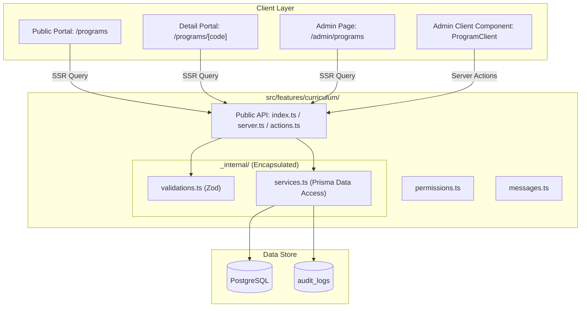

# Architecture Blueprint: Curriculum & Programs

## Component Hierarchy & Data Flow

## Security & Access Control
- Public: Anyone can read active programs via `/programs` and `/programs/[code]`.
- Admin: Requires `curriculum:read` to view table, `curriculum:manage` to create/edit/delete.
