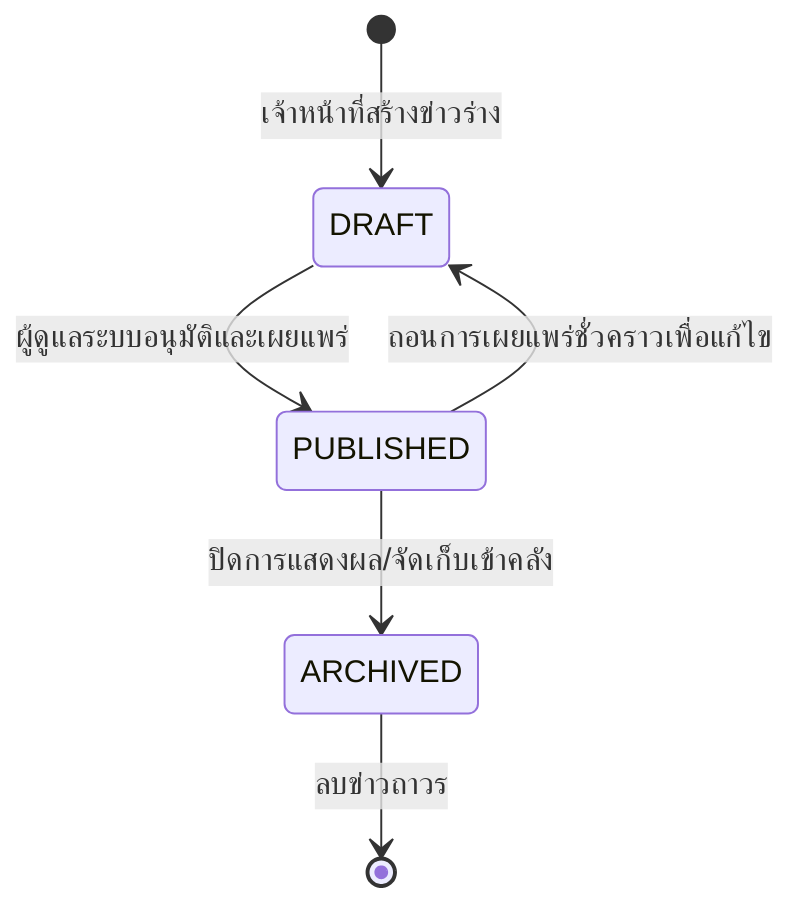

# Technical Architecture & Flow
## ฟีเจอร์: ระบบจัดการข่าวสารประชาสัมพันธ์ (News & Announcements)

### 1. โครงสร้างโฟลเดอร์ของฟีเจอร์ (Folder Structure)
```
src/features/news/
├── index.ts              # Client-safe exports (types, enums, DTOs)
├── server.ts             # Server functions (listPublishedNews, getNewsBySlug)
├── actions.ts            # Server Actions re-export
├── permissions.ts        # RBAC permissions (NEWS_P, NEWS_PERMISSIONS)
├── messages.ts           # i18n messages (TH/EN)
└── _internal/
    ├── services.ts       # Database queries & business logic
    ├── validations.ts    # Zod schemas (createNewsSchema, updateNewsSchema)
    ├── actions.ts        # Internal Server Actions implementation
    └── validations.test.ts # Unit tests for validations
```

### 2. Route Mapping
| เส้นทาง (Route) | ประเภท | รายละเอียด |
| :--- | :--- | :--- |
| `src/app/(portal)/news/page.tsx` | Server Component | หน้ารวมข่าวสารสาธารณะ กรองตามหมวดหมู่และค้นหา |
| `src/app/(portal)/news/[slug]/page.tsx` | Server Component | หน้ารายละเอียดข่าวฉบับเต็ม พร้อมรูปภาพและไฟล์แนบ |
| `src/app/(admin)/news/page.tsx` | Server Component | หน้าแดชบอร์ดจัดการข่าวสารฝั่งผู้ดูแลระบบ (Admin) |
| `src/app/(admin)/news/_components/news-client.tsx` | Client Component | ตารางข่าวสาร ตัวกรองสถานะ โมดอลเพิ่ม/แก้ไขข่าว |

### 3. Data Flow & Lifecycle


### 4. Permissions (RBAC)
ลงทะเบียนสิทธิ์ใน `src/permissions.ts`:
- `news:read` — สิทธิ์เข้าดูและอ่านข่าวสาร
- `news:manage` — สิทธิ์สร้างและแก้ไขเนื้อหาข่าวสาร
- `news:publish` — สิทธิ์เผยแพร่และปักหมุดข่าวสาร
- `news:delete` — สิทธิ์ลบข่าวสาร
