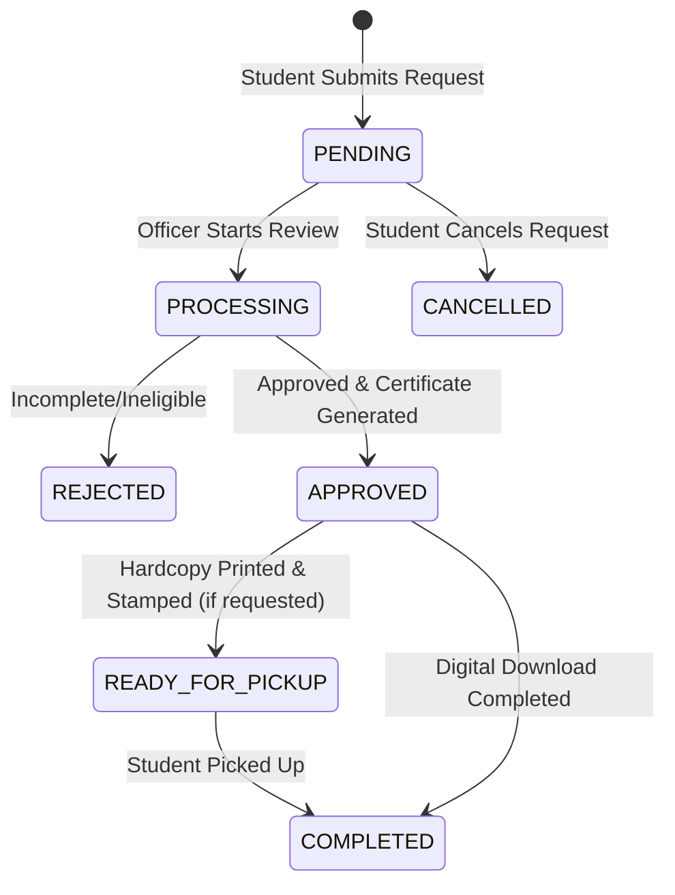

# Technical Architecture: Student Services & Credential Verification

## 1. Directory Structure
```
src/features/services/
├── index.ts                # Public client-safe types and schemas
├── server.ts               # Server-only loaders and queries
├── actions.ts              # Server Actions for mutations
├── permissions.ts          # SERVICES_P & permissions definitions
├── messages.ts             # Thai / English i18n dictionaries
└── _internal/
    ├── validations.ts      # Zod validation schemas
    ├── validations.test.ts # Unit tests for schemas
    ├── services.ts         # Prisma business logic & verification hash
    └── actions.ts          # Action implementations
```

## 2. Route Mapping
- Public Portal:
  - `src/app/(portal)/services/page.tsx` -> Service Catalog & My Requests
  - `src/app/(portal)/services/new/page.tsx` -> Request Application Form
  - `src/app/(portal)/verify/[code]/page.tsx` -> Public Credential Verification
- Admin Console:
  - `src/app/(admin)/admin/services/page.tsx` -> Admin Server Component
  - `src/app/(admin)/admin/services/_components/services-admin-client.tsx` -> Admin Review & Issuance Console

## 3. State Lifecycle & Transitions


## 4. Permissions
- `services:read` -> View services catalog and own requests.
- `services:request` -> Apply for student services & certificates.
- `services:manage` -> Review, approve, issue verifiable certificates, and mark hardcopies ready.
